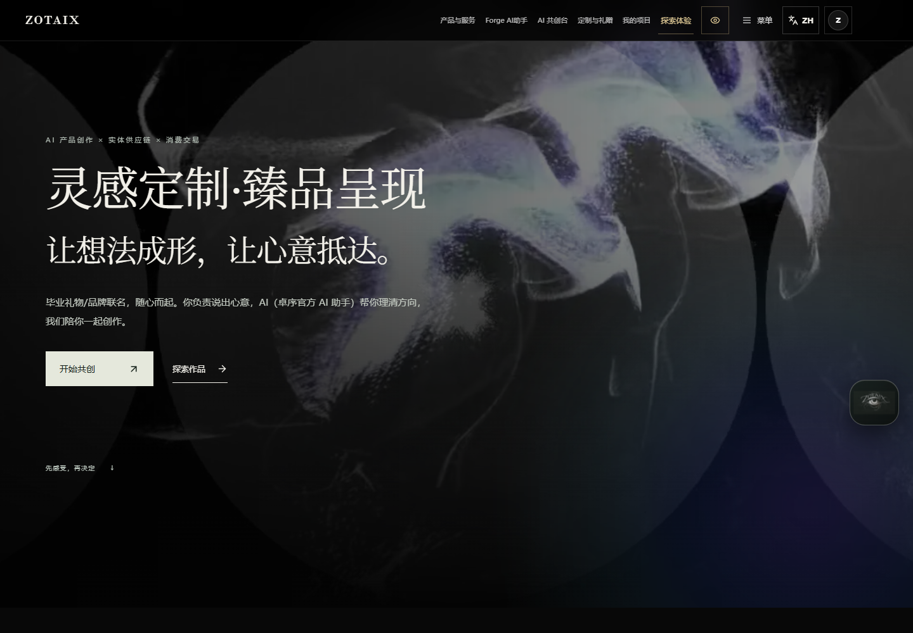
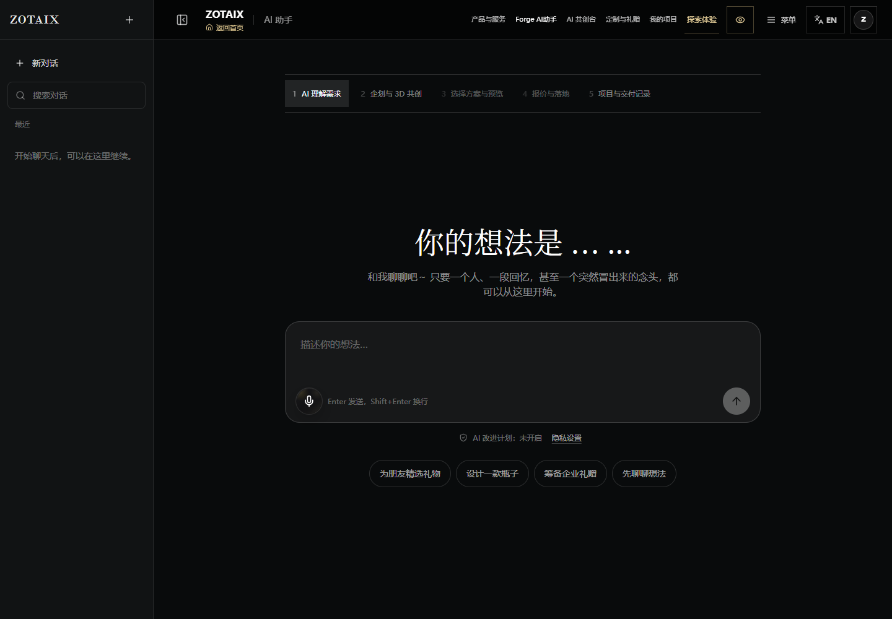
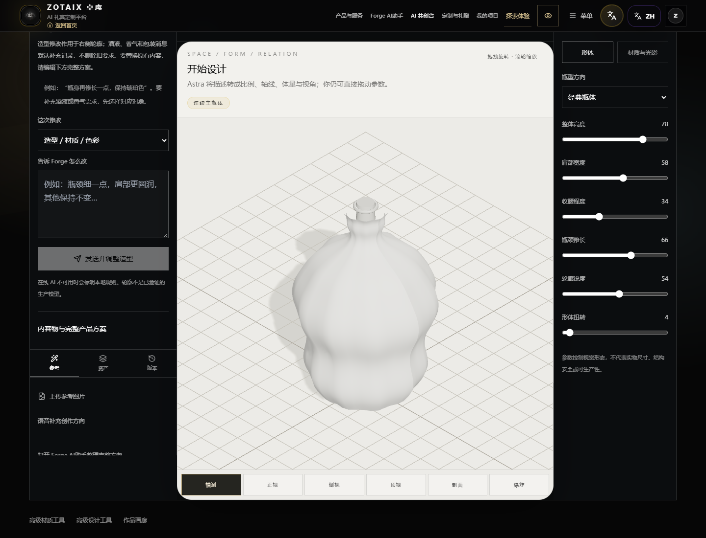
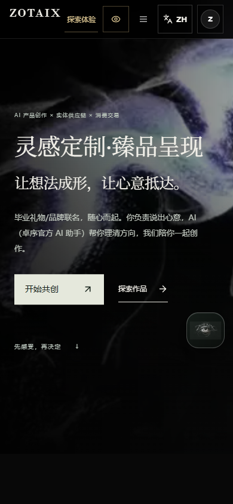

# ZOTAIX｜项目与界面展示

AI 产品创作与礼赠共创的界面预览。

本仓库用于公开展示项目介绍、界面截图和预览视频。**完整应用源码、原始模型资源及部署配置保存在独立私有仓库中，不在这里发布。**

即使下载本展示仓库的 ZIP，也只能获得这些展示材料，无法获得完整项目代码。

## 项目概览

ZOTAIX 将自然语言需求、产品方向、瓶器形体及材质预览组织到同一创作流程中，面向个人礼赠、品牌联名和企业定制场景。

| 界面 | 展示内容 |
| --- | --- |
| 首页 | 项目定位、作品展示和创作入口 |
| AI 助手 | 文字需求输入、对话入口和创作方向提示 |
| 共创工作台 | 3D 概念轮廓、形体参数及材质调整入口 |
| 手机版 | 适配手机屏幕的首页布局 |

以下截图来自项目的本地演示模式。它们展示界面和交互入口，不代表在线 AI、支付或云端保存服务已经完成配置。概念模型不等于可生产的实物方案。

## 首页

## AI 助手

## 共创工作台

## 手机版

## 界面预览视频

[查看或下载 18 秒界面预览](media/interface-preview.mp4)

该视频由上述实际运行截图轮播组成，用于快速浏览首页、AI 助手和共创工作台，并非在线功能演示录像。

## 展示内容范围

本仓库仅包含这份介绍、四张界面截图和一个截图轮播视频，不提供项目源码、模型原文件、安装包或运行所需的配置文件。
